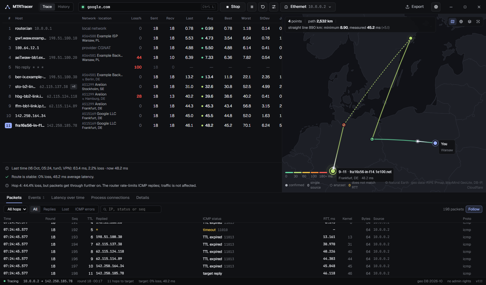
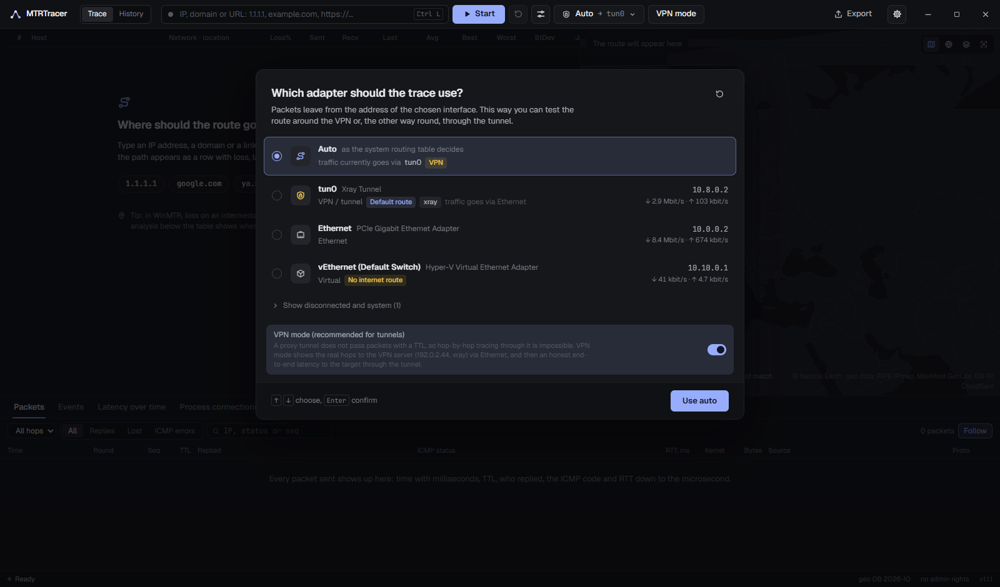
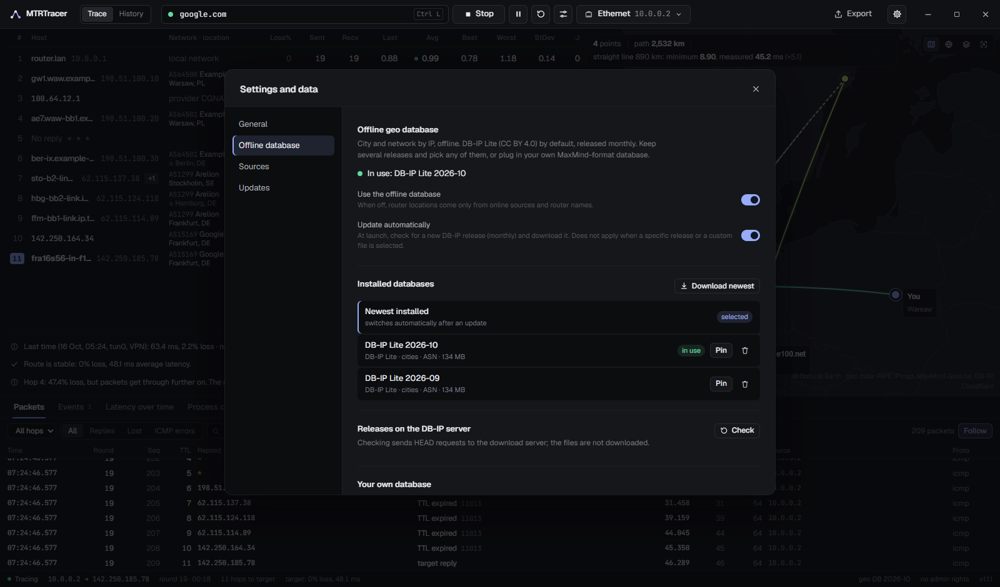
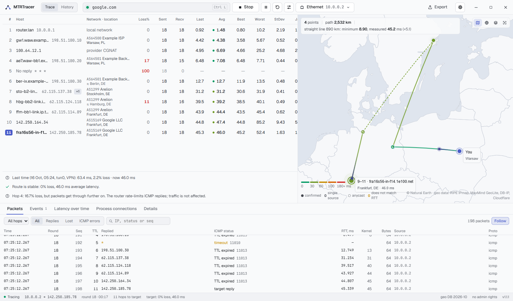
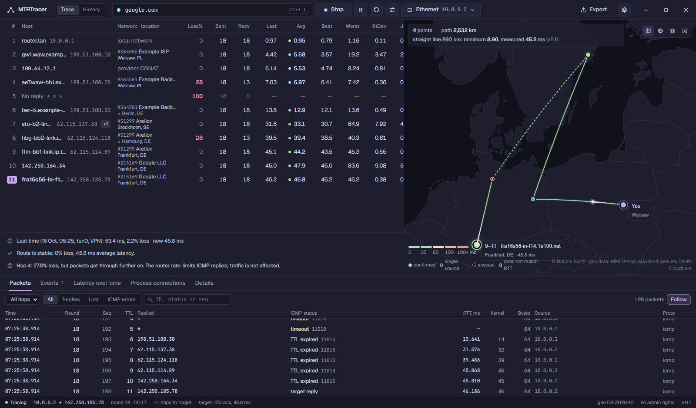
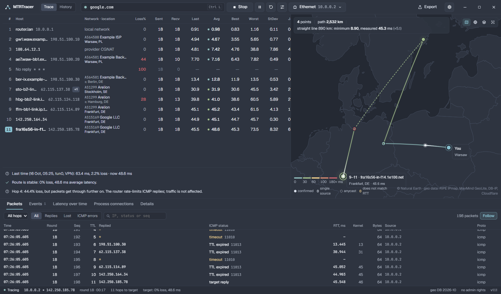

<div align="center">


# MTRTracer

**A route tracer in the spirit of WinMTR, with a modern interface.**<br>
Loss and latency on every hop, a route map checked against the speed of light, a raw log of every packet, an honest VPN mode and a measurement history.

[](https://www.anthropic.com/claude)
[](https://www.anthropic.com)

[](https://github.com/extraut/MTRTracer/releases/latest)
[](https://github.com/extraut/MTRTracer/actions/workflows/release.yml)
[](https://github.com/extraut/MTRTracer/releases)


[](LICENSE)

[**Website**](https://extraut.github.io/MTRTracer/) · [**Docs**](https://extraut.github.io/MTRTracer/docs.html) · [**Download**](https://github.com/extraut/MTRTracer/releases/latest)

[Русский](README.md) · **English**

<br>



<sub>The screenshot uses the built-in simulator: all addresses and places are demo values.</sub>

</div>

<br>

> [!IMPORTANT]
> **Public archive.** The author does not plan regular updates, but the app is built to keep living without them: the offline geo database, its version and the data sources can be updated and changed right in the app (Settings → Offline database / Sources), with no new release needed. Want to take the project further? Fork it — the MIT licence allows that, and the app can point its update check at your fork.

> [!NOTE]
> **The whole project was written by [Claude Opus 5.5](https://www.anthropic.com/claude) from [Anthropic](https://www.anthropic.com)** in Claude Code: the C# system layer, the network core for Windows and Linux, the React interface, the tests, the website and the docs. A human set the tasks, checked the result on a real machine and decided what came next.

## Features

| | |
|---|---|
| 🧭 **Adapter choice** | At start it asks which interface to trace through: Ethernet around the VPN, the tunnel, or "whatever the system decides". Packets leave from the chosen adapter's address. |
| 📊 **Stats like mtr and more** | Loss%, Sent, Recv, Last, Avg, Best, Worst, StDev, Gmean, Jttr, Javg, Jmax, Jint (RFC 3550), recent packet history. RTT with microsecond precision. |
| 🗺️ **Route map** | Flat map or globe with animated packets. Every point is checked by physics: a router cannot be farther away than light can travel in the measured RTT. |
| 🔬 **Every packet logged** | Time, round, seq, TTL, who replied, ICMP code, RTT by timer and by kernel, size, source. Export to TXT (like WinMTR), CSV, JSON and an HTML report. |
| 🛡️ **VPN mode** | For Xray, sing-box, Clash, WireGuard and similar: the real hops to the VPN server over the physical adapter, plus honest end-to-end latency to the target through the tunnel. |
| 🕓 **Measurement history** | Every run is saved. See how the route behaved in the afternoon and in the evening, compare two runs hop by hop. |
| 🔌 **Process connections** | Which programs hold network connections. Right-click an address → "Trace to this host". |
| 🧠 **Plain-language analysis** | Tells ICMP rate limiting on a router apart from real loss, finds latency jumps and route changes. |
| 🗂️ **Your data, your control** | "Settings and data": download a new or a specific offline database release, pin it, plug in your own MaxMind database (.mmdb), switch each geo source on or off, clear the cache, check for updates. |
| 🌐 **English and Russian** | Switch on the fly: interface, route analysis, events, reports. |
| 🎨 **Themes** | Graphite (dark), Light, Catppuccin Mocha, Nord, or follow the system. |
| 🪶 **Nothing extra** | No admin rights, no Npcap/Wireshark, no telemetry. The map and the offline database work without internet. |

<details>
<summary><b>Adapter selection</b></summary>
<br>

</details>

<details>
<summary><b>Settings and data: offline database, sources, updates</b></summary>
<br>

</details>

<details>
<summary><b>Themes: Light, Catppuccin Mocha, Nord</b></summary>
<br>



</details>

## What's new in 1.1.1

- **Settings and data** (gear icon in the title bar): DB-IP offline database releases — download the newest, pick a month, pin it, delete it; import your own MaxMind GeoLite2 / DB-IP / IPinfo database (.mmdb, .mmdb.gz, .tar.gz) from a file or a link; the DB-IP download address is editable.
- **Data sources**: each one (RIPE IPmap, RIPEstat, ip-api.com, Cloudflare, Team Cymru, router names, offline database) can be turned on or off, and you can see exactly what goes out. Clear the response cache.
- **Updates**: check the latest GitHub release with one button, with links to the files; point it at your own fork.
- **English** for the interface and every message the app produces.
- **Themes**: Light, Catppuccin Mocha, Nord, System.

## Download

Ready-made builds are in **[Releases](https://github.com/extraut/MTRTracer/releases/latest)**. GitHub Actions builds them from this repository's sources ([workflow](.github/workflows/release.yml)), without debug symbols; `SHA256SUMS.txt` sits next to them.

| File | System |
|---|---|
| `MTRTracer-windows-x64.exe` | Windows 10/11 x64. A single file, no installation. Needs the WebView2 Runtime (built into Windows 11). |
| `mtrtracer-linux-x64.tar.gz` | Linux x64: the program, an icon, a desktop entry, `install.sh` |
| `mtrtracer-linux-arm64.tar.gz` | Linux ARM64: Raspberry Pi 4/5, ARM servers |

> [!TIP]
> The exe is not code-signed, so SmartScreen may ask for confirmation on first launch: "More info" → "Run anyway". If you would rather not trust a prebuilt file, build it yourself — it is one command.

**Linux:**

```bash
sudo apt install libwebkit2gtk-4.1-0 libnotify4      # the window; without it use mtrtracer --browser
tar -xzf mtrtracer-linux-x64.tar.gz && cd linux-x64 && ./install.sh
mtrtracer
```

ICMP without root goes through ping sockets (`net.ipv4.ping_group_range`, allowed by default on Ubuntu, Fedora, Debian 12+, Arch). If they are not allowed: `sudo sysctl -w net.ipv4.ping_group_range="0 2147483647"` or `./install.sh --setcap`.

## Building from source

You need the [.NET 10 SDK](https://dotnet.microsoft.com/download) and [Node.js 20+](https://nodejs.org). Visual Studio is not required.

<table>
<tr><th>Windows (PowerShell)</th><th>Linux</th></tr>
<tr><td>

```powershell
winget install Microsoft.DotNet.SDK.10
winget install OpenJS.NodeJS.LTS
.\build.ps1
# → dist\MTRTracer.exe
```

</td><td>

```bash
sudo apt install dotnet-sdk-10.0 nodejs npm
./build.sh                # or --arch arm64
# → dist-linux/mtrtracer-linux-x64.tar.gz
```

</td></tr>
</table>

The scripts build the interface (`ui/dist`), run the offline tests and publish a single self-contained file. Options: `-FrameworkDependent` (small exe, needs the .NET 10 Desktop Runtime), `-SkipTests`, `-Linux` (cross-build Linux from Windows).

<details>
<summary><b>The same by hand</b></summary>

```powershell
cd ui; npm ci; npm run build; cd ..
dotnet test src/MTRTracer.Tests -c Release
dotnet publish src/MTRTracer.App -c Release -r win-x64 -o dist --self-contained true -p:PublishSingleFile=true -p:IncludeNativeLibrariesForSelfExtract=true -p:EnableCompressionInSingleFile=true
```

The interface is embedded into the exe during `dotnet publish`, so `npm run build` has to run first.
</details>

<details>
<summary><b>Working on the interface</b></summary>

The interface runs in a normal browser on demo data, with no network and no C# part:

```bash
cd ui && npm ci && npm run dev     # http://localhost:5173
```

The built-in simulator (`ui/src/bridge/mock.ts`) plays adapters, a trace with loss and load balancing, the TCP fallback (target `blocked.example`), a DNS error (`nonexistent.invalid`), VPN mode, history and the settings window.

The real app with hot reload of the interface:

```powershell
cd ui; npm run dev                                         # terminal 1
$env:MTRTRACER_DEV_URL = "http://localhost:5173"
dotnet run --project src/MTRTracer.App                     # terminal 2
```

F12 (DevTools) and Ctrl+R work in dev mode. In a normal build DevTools are enabled with `MTRTRACER_DEVTOOLS=1`.
</details>

## Offline database and sources

Open "Settings and data" with the gear icon in the title bar or by clicking "geo DB …" in the status bar.

| What | How |
|---|---|
| Update the database | "Download newest", or turn on automatic updates (monthly, at launch) |
| A specific release | "Check" lists the months the DB-IP server has; download and pin any of them |
| Your own database | an .mmdb / .mmdb.gz / .tar.gz file (DB-IP Lite, MaxMind GeoLite2 City/ASN, IPinfo ASN) or an https:// link to one |
| DB-IP moved its files | the "DB-IP release address" field, a template with {name} and {month} |
| Sources | every online and offline source has its own switch, plus a master switch for online refinement |
| Cache | online answers are kept for 2–30 days and can be cleared |
| App updates | "Check for updates"; the repository can be replaced with your fork |

The app never downloads or replaces itself: release files open in your browser.

## How router locations are found

Several sources give their opinion about each address, each with the time it was fetched:

| Source | What it gives |
|---|---|
| **RIPE IPmap** | location from real RIPE Atlas latency measurements, made for routers |
| **Router name** | city codes in reverse DNS (`fra`, `ams`, `waw-bb1`…) |
| **MaxMind GeoLite** via RIPEstat | updated weekly |
| **DB-IP Lite** | offline database, works without internet |
| **ip-api.com** | ISP names and a fallback location |
| **Cloudflare** | your own location (`speed.cloudflare.com/meta`) and the data centre for sites behind Cloudflare (`/cdn-cgi/trace`) |

Then physics checks every candidate: light in fibre covers about 100 km per 1 ms of RTT. A router cannot be farther from you than its minimum RTT (and that of every later hop) allows, and the path through the previous router must fit into the RTT too. A contradicting source is discarded; the hop details show which one and why. Routers that no source could place consistently are still drawn on the map, marked as unconfirmed. Anycast addresses (1.1.1.1, 8.8.8.8 and the like) are placed at the nearest confirmed router. You can set your own starting point by hand on the Details tab.

## VPN mode

Proxy tunnels (Xray, sing-box, Clash, tun2socks) carry only TCP/UDP streams, so hop-by-hop tracing through them is impossible, and the tunnel often answers pings itself. The app detects this and offers VPN mode:

- finds the VPN client process and its server in the connection table (the server can be set by hand);
- traces the real hops to the VPN server over the physical adapter;
- measures end-to-end latency to the target through the tunnel over a persistent HTTPS connection;
- shows the VPN exit (IP, provider, city, Cloudflare data centre) and an estimate of the "server → target" leg.

## What goes over the network

- **Trace packets** — from the chosen adapter's address. If you pick Ethernet around the VPN, routers on the path see your real IP.
- **DB-IP Lite** (about 60 MB to download, about 130 MB on disk) is downloaded at first launch from download.db-ip.com; monthly updates can be turned off and a release can be pinned.
- **Online refinement** (a switch in settings): route router addresses go to RIPE IPmap, RIPEstat and ip-api.com. The app asks Cloudflare for your location from the physical adapter's address. Turn the switch or single sources off, or set your location by hand, if you do not want that.
- **Update check** — a request to api.github.com, only when you press the button.
- **VPN mode**: the trace to the VPN server leaves from your real IP, along the same path the VPN client uses anyway.
- **Detailed base map** (OpenFreeMap) — only when switched on. By default the map is fully offline (Natural Earth inside the app).
- **No telemetry.**

App data: `%LOCALAPPDATA%\MTRTracer\` on Windows, `~/.local/share/MTRTracer/` on Linux (`settings.json`, `history.db`, geo caches and databases, an NDJSON log of each session).

## Limitations

- Router geolocation is approximate, usually to the city.
- UDP/TCP tracing and MPLS labels need raw sockets and admin rights and are not part of this version. TCP is used as a ping to the target when it does not answer ICMP.
- UDP tunnels (WireGuard, Hysteria) do not appear in the TCP connection table; set their server by hand.

## Layout

```
src/MTRTracer.Core/     network logic without UI (net10.0, Windows and Linux)
  Native/               Windows: iphlpapi; Linux: ip route, /proc/net, /proc/*/fd
  Probing/              ICMP: IcmpSendEcho2Ex or Linux ping sockets with IP_RECVERR; TCP ping; Path MTU
  Adapters/             adapters, classification, routes, tunnel detector
  Mtr/                  MTR session (a thread per TTL), statistics, analyzer, VPN mode
  Dns/                  own DNS client: fallback resolve, reverse DNS, ASN via Team Cymru
  Geo/                  geo sources, offline database manager and RouteGeoSolver (speed-of-light check)
  History/              measurement log (SQLite)
  Connections/          process connections without admin rights
  Export/               TXT, CSV, JSON, HTML
  Updates/              GitHub release check
src/MTRTracer.App/      Windows: frameless WPF window + WebView2
src/MTRTracer.Linux/    Linux: server on 127.0.0.1 + WebSocket bridge + Photino (WebKitGTK) window or browser
src/MTRTracer.Tests/    unit tests (never touch the network)
ui/                     interface: React 19, TypeScript, Vite, Zustand, MapLibre, uPlot
site/                   project website (GitHub Pages)
packaging/linux/        install.sh and the .desktop entry
```

## License

[MIT](LICENSE): use, change and redistribute the program freely, commercially too, as long as the licence text stays with it. Provided "as is", without warranty.

Third-party data and components keep their own licences: DB-IP Lite (CC BY 4.0), Natural Earth (public domain), Geist and JetBrains Mono fonts (SIL OFL 1.1), Catppuccin and Nord palettes (MIT), npm and NuGet packages (their own licences).

## Credits

Map: [Natural Earth](https://www.naturalearthdata.com). Geo data: [RIPE IPmap](https://ipmap.ripe.net), [RIPEstat](https://stat.ripe.net), MaxMind GeoLite, [DB-IP](https://db-ip.com) (CC BY 4.0), [Cloudflare](https://speed.cloudflare.com), [ip-api.com](https://ip-api.com). Fonts: Geist, JetBrains Mono (OFL). Windows: [WebView2](https://developer.microsoft.com/microsoft-edge/webview2), [Photino](https://www.tryphotino.io). Palettes: [Catppuccin](https://catppuccin.com), [Nord](https://www.nordtheme.com).

<div align="center">
<br>
<sub>Made with <a href="https://www.anthropic.com/claude">Claude Opus 5.5</a> · <a href="https://extraut.github.io/MTRTracer/">extraut.github.io/MTRTracer</a></sub>
</div>
