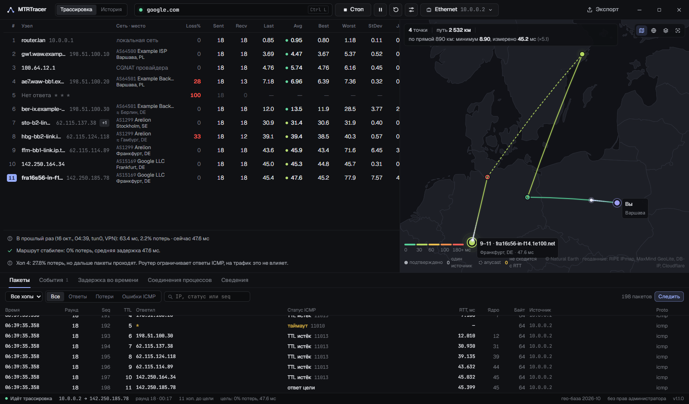
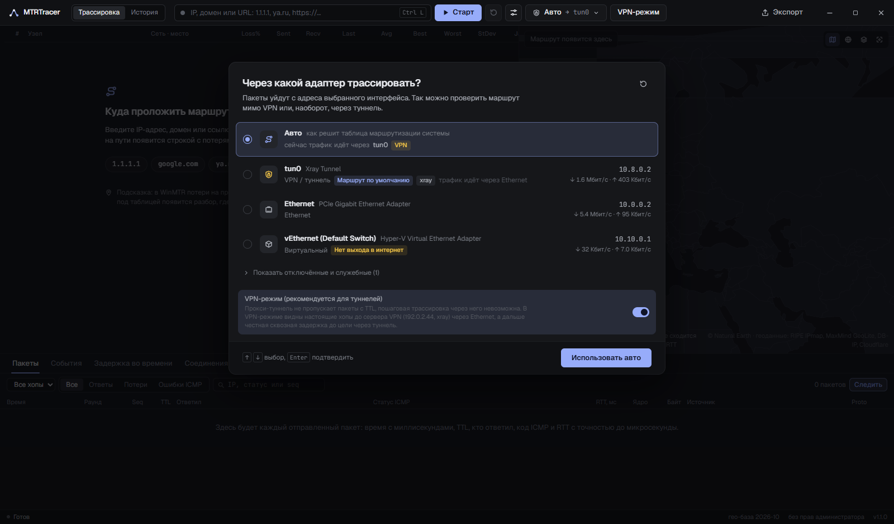

<div align="center">


# MTRTracer

**Трассировка маршрута в духе WinMTR, но с современным интерфейсом.**<br>
Потери и задержка на каждом хопе, карта маршрута с проверкой по скорости света, сырой лог каждого пакета, честный VPN-режим и журнал замеров.

[](https://www.anthropic.com/claude)
[](https://www.anthropic.com)

[](https://github.com/extraut/MTRTracer/releases/latest)
[](https://github.com/extraut/MTRTracer/actions/workflows/release.yml)
[](https://github.com/extraut/MTRTracer/releases)


[**Сайт**](https://extraut.github.io/MTRTracer/) · [**Документация**](https://extraut.github.io/MTRTracer/docs.html) · [**Скачать**](https://github.com/extraut/MTRTracer/releases/latest)

<br>



<sub>Скриншот сделан на встроенном симуляторе: все адреса и места демонстрационные.</sub>

</div>

<br>

> [!NOTE]
> **Проект целиком написан моделью [Claude Opus 5.5](https://www.anthropic.com/claude) от [Anthropic](https://www.anthropic.com)** в Claude Code: системная часть на C#, сетевое ядро для Windows и Linux, интерфейс на React, тесты, сайт и документация. Человек ставил задачи, проверял результат на своей машине и решал, что делать дальше.

## Возможности

| | |
|---|---|
| 🧭 **Выбор адаптера** | При запуске спрашивает, через какой интерфейс трассировать: Ethernet в обход VPN, туннель или «как решит система». Пакеты уходят с адреса выбранного адаптера. |
| 📊 **Статистика как в mtr и шире** | Loss%, Sent, Recv, Last, Avg, Best, Worst, StDev, Gmean, Jttr, Javg, Jmax, Jint (RFC 3550), история последних пакетов. RTT с точностью до микросекунд. |
| 🗺️ **Карта маршрута** | Плоская карта или глобус, анимация пакетов. Каждая точка проверяется физикой: узел не может быть дальше, чем свет успевает пройти за измеренный RTT. |
| 🔬 **Лог каждого пакета** | Время, раунд, seq, TTL, кто ответил, код ICMP, RTT по таймеру и по ядру, размер, источник. Экспорт в TXT (как WinMTR), CSV, JSON и HTML-отчёт. |
| 🛡️ **VPN-режим** | Для Xray, sing-box, Clash, WireGuard и т.п.: настоящие хопы до сервера VPN через физический адаптер и честная сквозная задержка до цели через туннель. |
| 🕓 **История замеров** | Каждый запуск сохраняется. Видно, как маршрут вёл себя днём и вечером, можно сравнить два запуска по хопам. |
| 🔌 **Соединения процессов** | Какие программы держат сетевые соединения. ПКМ по адресу → «Трассировать до узла». |
| 🧠 **Разбор словами** | Анализатор отличает ограничение ICMP на роутере от настоящих потерь, находит скачки задержки и смену маршрута. |
| 🪶 **Без лишнего** | Без прав администратора, без Npcap/Wireshark, без телеметрии. Карта и офлайн-база работают без интернета. |

<details>
<summary><b>Окно выбора адаптера</b></summary>
<br>

</details>

## Скачать

Готовые сборки лежат в **[Releases](https://github.com/extraut/MTRTracer/releases/latest)**. Их собирает GitHub Actions из исходников этого репозитория ([workflow](.github/workflows/release.yml)), без отладочных символов; рядом лежит `SHA256SUMS.txt`.

| Файл | Система |
|---|---|
| `MTRTracer-windows-x64.exe` | Windows 10/11 x64. Один файл, установка не нужна. Нужен WebView2 Runtime (в Windows 11 уже есть). |
| `mtrtracer-linux-x64.tar.gz` | Linux x64: программа, иконка, ярлык, `install.sh` |
| `mtrtracer-linux-arm64.tar.gz` | Linux ARM64: Raspberry Pi 4/5, ARM-серверы |

> [!TIP]
> Exe не подписан сертификатом, поэтому SmartScreen при первом запуске может спросить подтверждение: «Подробнее» → «Выполнить в любом случае». Не хотите доверять готовому файлу — соберите сами, это одна команда.

**Linux:**

```bash
sudo apt install libwebkit2gtk-4.1-0 libnotify4      # окно; без него работает mtrtracer --browser
tar -xzf mtrtracer-linux-x64.tar.gz && cd linux-x64 && ./install.sh
mtrtracer
```

ICMP без root идёт через ping-сокеты (`net.ipv4.ping_group_range`, по умолчанию разрешено в Ubuntu, Fedora, Debian 12+, Arch). Если запрещено: `sudo sysctl -w net.ipv4.ping_group_range="0 2147483647"` или `./install.sh --setcap`.

## Сборка из исходников

Нужны [.NET 10 SDK](https://dotnet.microsoft.com/download) и [Node.js 20+](https://nodejs.org). Visual Studio не нужна.

<table>
<tr><th>Windows (PowerShell)</th><th>Linux</th></tr>
<tr><td>

```powershell
winget install Microsoft.DotNet.SDK.10
winget install OpenJS.NodeJS.LTS
.\build.ps1
# → dist\MTRTracer.exe
```

</td><td>

```bash
sudo apt install dotnet-sdk-10.0 nodejs npm
./build.sh                # или --arch arm64
# → dist-linux/mtrtracer-linux-x64.tar.gz
```

</td></tr>
</table>

Скрипты собирают интерфейс (`ui/dist`), прогоняют офлайн-тесты и публикуют один самодостаточный файл. Параметры: `-FrameworkDependent` (маленький exe, нужен .NET 10 Desktop Runtime), `-SkipTests`, `-Linux` (кросс-сборка Linux из Windows).

<details>
<summary><b>То же вручную</b></summary>

```powershell
cd ui; npm ci; npm run build; cd ..
dotnet test src/MTRTracer.Tests -c Release
dotnet publish src/MTRTracer.App -c Release -r win-x64 -o dist --self-contained true -p:PublishSingleFile=true -p:IncludeNativeLibrariesForSelfExtract=true -p:EnableCompressionInSingleFile=true
```

Интерфейс встраивается в exe на шаге `dotnet publish`, поэтому `npm run build` должен идти раньше.
</details>

<details>
<summary><b>Разработка интерфейса</b></summary>

Интерфейс можно смотреть в обычном браузере на демо-данных, без сети и без C#-части:

```bash
cd ui && npm ci && npm run dev     # http://localhost:5173
```

Встроенный симулятор (`ui/src/bridge/mock.ts`) изображает адаптеры, трассировку с потерями и балансировкой, TCP-фолбэк (цель `blocked.example`), ошибку DNS (`nonexistent.invalid`), VPN-режим и историю.

Настоящее приложение с горячей перезагрузкой интерфейса:

```powershell
cd ui; npm run dev                                         # терминал 1
$env:MTRTRACER_DEV_URL = "http://localhost:5173"
dotnet run --project src/MTRTracer.App                     # терминал 2
```

В dev-режиме работают F12 (DevTools) и Ctrl+R. В обычной сборке DevTools включаются переменной `MTRTRACER_DEVTOOLS=1`.
</details>

## Как определяется место узлов

Для каждого адреса собираются мнения нескольких источников, у каждого видна дата получения:

| Источник | Что даёт |
|---|---|
| **RIPE IPmap** | геолокация по реальным замерам задержек RIPE Atlas, сделана именно для роутеров |
| **Имя роутера** | коды городов в обратном DNS (`fra`, `ams`, `waw-bb1`…) |
| **MaxMind GeoLite** через RIPEstat | обновляется еженедельно |
| **DB-IP Lite** | офлайн-база, работает без интернета |
| **ip-api.com** | провайдер и запасной вариант |
| **Cloudflare** | ваше местоположение (`speed.cloudflare.com/meta`) и дата-центр для сайтов за Cloudflare (`/cdn-cgi/trace`) |

Затем каждый вариант проверяется физикой: свет в оптоволокне проходит около 100 км за 1 мс RTT. Узел не может быть дальше от вас, чем позволяет минимальный RTT (его и всех следующих хопов), и путь через предыдущий узел тоже должен укладываться в RTT. Противоречащий источник отбрасывается, в деталях хопа видно, какой и почему. Узлы, для которых не прошёл ни один источник, всё равно ставятся на карту, но помечаются как неподтверждённые. Anycast-адреса (1.1.1.1, 8.8.8.8 и т.п.) ставятся в точку ближайшего подтверждённого узла. Свою точку отсчёта можно задать вручную во вкладке «Сведения».

## VPN-режим

Прокси-туннели (Xray, sing-box, Clash, tun2socks) передают только TCP/UDP-потоки, поэтому трассировка по хопам через них невозможна, а на пинг туннель часто отвечает сам. Программа это распознаёт и предлагает VPN-режим:

- находит процесс VPN-клиента и его сервер по таблице соединений (сервер можно указать вручную);
- трассирует настоящие хопы до сервера VPN через физический адаптер;
- меряет сквозную задержку до цели через туннель по постоянному HTTPS-соединению;
- показывает выход VPN (IP, провайдер, город, дата-центр Cloudflare) и оценку участка «сервер → цель».

## Что уходит в сеть

- **Пакеты трассировки** — с адреса выбранного адаптера. Если выбрать Ethernet в обход VPN, роутеры по пути увидят ваш реальный IP.
- **DB-IP Lite** (~60 МБ) скачивается при первом запуске с download.db-ip.com и обновляется раз в месяц.
- **Онлайн-уточнение** (переключатель в параметрах): адреса узлов маршрута уходят в RIPE IPmap, RIPEstat и ip-api.com. Своё местоположение программа спрашивает у Cloudflare с адреса физического адаптера. Выключите переключатель или задайте место вручную, если это нежелательно.
- **VPN-режим**: трассировка до сервера VPN идёт с реального IP, по тому же пути, по которому VPN-клиент и так подключается.
- **Подробная подложка карты** (OpenFreeMap) — только по кнопке. По умолчанию карта полностью офлайн (Natural Earth внутри программы).
- **Телеметрии нет.**

Данные программы: `%LOCALAPPDATA%\MTRTracer\` на Windows, `~/.local/share/MTRTracer/` на Linux (`settings.json`, `history.db`, кэши геоданных, NDJSON-лог каждой сессии).

## Ограничения

- Геолокация роутеров приблизительная, обычно до города.
- UDP/TCP-трассировка и MPLS-метки требуют raw-сокетов и прав администратора, в эту версию не вошли. TCP используется как пинг цели, если она не отвечает на ICMP.
- UDP-туннели (WireGuard, Hysteria) не видны в таблице TCP-соединений, их сервер нужно указать вручную.
- Интерфейс только на русском.

## Устройство

```
src/MTRTracer.Core/     сетевая логика без UI (net10.0, Windows и Linux)
  Native/               Windows: iphlpapi; Linux: ip route, /proc/net, /proc/*/fd
  Probing/              ICMP: IcmpSendEcho2Ex или Linux ping-сокеты с IP_RECVERR; TCP-пинг; Path MTU
  Adapters/             адаптеры, классификация, маршруты, детектор туннелей
  Mtr/                  сессия MTR (поток на каждый TTL), статистика, анализатор, VPN-режим
  Dns/                  свой DNS-клиент: фолбэк-резолв, обратный DNS, ASN через Team Cymru
  Geo/                  источники геолокации и RouteGeoSolver (проверка по скорости света)
  History/              журнал замеров (SQLite)
  Connections/          соединения процессов без прав администратора
  Export/               TXT, CSV, JSON, HTML
src/MTRTracer.App/      Windows: окно WPF без рамки + WebView2
src/MTRTracer.Linux/    Linux: сервер на 127.0.0.1 + WebSocket-мост + окно Photino (WebKitGTK) или браузер
src/MTRTracer.Tests/    юнит-тесты (в сеть не ходят)
ui/                     интерфейс: React 19, TypeScript, Vite, Zustand, MapLibre, uPlot
site/                   сайт проекта (GitHub Pages)
packaging/linux/        install.sh и ярлык .desktop
```

## Благодарности

Карта: [Natural Earth](https://www.naturalearthdata.com). Геоданные: [RIPE IPmap](https://ipmap.ripe.net), [RIPEstat](https://stat.ripe.net), MaxMind GeoLite, [DB-IP](https://db-ip.com) (CC BY 4.0), [Cloudflare](https://speed.cloudflare.com), [ip-api.com](https://ip-api.com). Шрифты: Geist, JetBrains Mono (OFL). Окна: [WebView2](https://developer.microsoft.com/microsoft-edge/webview2), [Photino](https://www.tryphotino.io).

<div align="center">
<br>
<sub>Сделано с <a href="https://www.anthropic.com/claude">Claude Opus 5.5</a> · <a href="https://extraut.github.io/MTRTracer/">extraut.github.io/MTRTracer</a></sub>
</div>
